# aroma-pacifico-diagrams

Diagram catalog for the Aroma Pacífico coffee traceability platform across Cauca, Huila, and Tolima (academic DevOps challenge).

This repository contains diagram sources (uncompressed UTF-8 Draw.io XML) alongside publication-grade vector exports (SVG) and high-resolution bitmap previews (PNG). It models runtime architecture, multi-account isolation, network routing, security perimeters, lifecycle state machines, execution sequences, and Track B Infrastructure as Code (IaC) implementation boxes D01 through D13.

---

## Master Diagram Catalog

Traceability Rule: Every D-box that a diagram badges on a component or names in its scope/legend is listed in the catalog and indexed in the traceability table.

| Folder | Diagram Title | Preview | Vector Export | Source | Source Design Document | IaC Traceability |
|---|---|---|---|---|---|---|
| `complete/` | Complete Architecture (Runtime) | [PNG](complete/architecture.png) | [SVG](complete/architecture.svg) | [Draw.io](complete/architecture.drawio) | `docs/architecture.md` §4, §7, §11, §14 | D01-D13 |
| `complete/` | Complete Architecture (IaC Traceability) | [PNG](complete/architecture-iac.png) | [SVG](complete/architecture-iac.svg) | [Draw.io](complete/architecture.drawio) | `docs/architecture.md` §14, `docs/automation-and-pipelines.md` §3-5 | D01-D13 |
| `accounts/` | Landing Zone, Governance & Auditing | [PNG](accounts/landing-zone.png) | [SVG](accounts/landing-zone.svg) | [Draw.io](accounts/landing-zone.drawio) | `docs/landing-zone.md` §3-7, `docs/security-and-identity.md` §2-4 | D02, D03, D04, D06, D09 |
| `network/` | Cloud and Site Addressing Plan | [PNG](network/addressing-plan.png) | [SVG](network/addressing-plan.svg) | [Draw.io](network/addressing-plan.drawio) | `docs/addressing-plan.md` §2-5 | D04, D05 |
| `network/` | Collection Center Network Pattern | [PNG](network/collection-center.png) | [SVG](network/collection-center.svg) | [Draw.io](network/collection-center.drawio) | `docs/collection-center-network.md` §2-6, `docs/firewall-policy.md` §4 | D04, D05, D07 |
| `network/` | End-to-End Connectivity Architecture | [PNG](network/connectivity.png) | [SVG](network/connectivity.svg) | [Draw.io](network/connectivity.drawio) | `docs/connectivity.md` §2-11 | D04, D05, D06, D07, D08, D09, D10 |
| `network/` | No-Signal Handling & Alert Sequence | [PNG](network/no-signal-sequence.png) | [SVG](network/no-signal-sequence.svg) | [Draw.io](network/no-signal-sequence.drawio) | `docs/connectivity.md` §4.3, §6, §7, §8 | D09, D10 |
| `security/` | Perimeter & Cloud Firewall Policy | [PNG](security/firewall-policy.png) | [SVG](security/firewall-policy.svg) | [Draw.io](security/firewall-policy.drawio) | `docs/firewall-policy.md` §3-6 | D04, D05, D07 |
| `security/` | Identity & Access Architecture | [PNG](security/identity-and-access.png) | [SVG](security/identity-and-access.svg) | [Draw.io](security/identity-and-access.drawio) | `docs/security-and-identity.md` §2-7, §10 | D02, D06, D08, D09 |
| `security/` | Credential & Revocation Sequence | [PNG](security/revocation-sequence.png) | [SVG](security/revocation-sequence.svg) | [Draw.io](security/revocation-sequence.drawio) | `docs/security-and-identity.md` §10 | D06, D08 |
| `flows/` | Drone Fumigation Sequence | [PNG](flows/drone-fumigation-sequence.png) | [SVG](flows/drone-fumigation-sequence.svg) | [Draw.io](flows/drone-fumigation-sequence.drawio) | `docs/drone-service.md` §3-6, §10 | D04, D06, D08, D09, D10 |
| `flows/` | Drone State Machines | [PNG](flows/drone-state-machines.png) | [SVG](flows/drone-state-machines.svg) | [Draw.io](flows/drone-state-machines.drawio) | `docs/drone-service.md` §5 | D06, D09, D10 |
| `flows/` | Farm Monitoring & Alert Sequence | [PNG](flows/farm-monitoring-sequence.png) | [SVG](flows/farm-monitoring-sequence.svg) | [Draw.io](flows/farm-monitoring-sequence.drawio) | `docs/farm-monitoring.md` §3-7, `docs/connectivity.md` §8 | D06, D08, D09, D10 |
| `flows/` | Inference Functions Architecture | [PNG](flows/inference-functions.png) | [SVG](flows/inference-functions.svg) | [Draw.io](flows/inference-functions.drawio) | `docs/inference-functions.md` §2-6, §10, `docs/adr/adr-004-drone-capability-orchestration.md` | D06, D09, D10 |
| `flows/` | Sack & Trip Custody Sequence | [PNG](flows/sack-and-trip-sequence.png) | [SVG](flows/sack-and-trip-sequence.svg) | [Draw.io](flows/sack-and-trip-sequence.drawio) | `docs/sack-and-trip.md` §2, §4, §5, §7 | D04, D05, D06, D07 |
| `flows/` | Sack Lifecycle State Machine | [PNG](flows/sack-states.png) | [SVG](flows/sack-states.svg) | [Draw.io](flows/sack-states.drawio) | `docs/sack-and-trip.md` §3 | D04, D05, D06 |
| `pipelines/` | Ingestion & Flight-Object Pipelines | [PNG](pipelines/ingestion-and-flight-objects.png) | [SVG](pipelines/ingestion-and-flight-objects.svg) | [Draw.io](pipelines/ingestion-and-flight-objects.drawio) | `docs/automation-and-pipelines.md` §6-7, `docs/farm-monitoring.md` §3-5 | D08, D09, D10 |
| `pipelines/` | Platform CI/CD Deployment Pipeline | [PNG](pipelines/platform-pipeline.png) | [SVG](pipelines/platform-pipeline.svg) | [Draw.io](pipelines/platform-pipeline.drawio) | `docs/automation-and-pipelines.md` §3-5, §8, §10 | D01, D02, D03, D04, D05, D06, D08, D10, D11, D12, D13 |
| `pipelines/` | IaC CI & Module Release Sequence | [PNG](pipelines/iac-ci-sequence.png) | [SVG](pipelines/iac-ci-sequence.svg) | [Draw.io](pipelines/iac-ci-sequence.drawio) | `standards/iac-rules/` (pc-iac-015, pc-iac-027, pc-iac-028), ADR-003 | D01, D11, D13 |
| `pipelines/` | IaC CD Provisioning Sequence | [PNG](pipelines/iac-provisioning-sequence.png) | [SVG](pipelines/iac-provisioning-sequence.svg) | [Draw.io](pipelines/iac-provisioning-sequence.drawio) | `docs/cd-pipeline.md` §1-5, ADR-003, ASM-172, ASM-178, ASM-320 | D01, D02, D04, D06, D12, D13 |
| `pipelines/` | IaC Teardown & Rollback Sequence | [PNG](pipelines/iac-teardown-and-rollback-sequence.png) | [SVG](pipelines/iac-teardown-and-rollback-sequence.svg) | [Draw.io](pipelines/iac-teardown-and-rollback-sequence.drawio) | `docs/cd-pipeline.md` §7, ASM-157, ASM-174, ASM-184, ASM-320 | D01, D02, D04, D06, D12, D13 |
| `legacy/` | 2020 Legacy Mapping (Keep/Retire/Replace) | [PNG](legacy/legacy-2020.png) | [SVG](legacy/legacy-2020.svg) | [Draw.io](legacy/legacy-2020.drawio) | `docs/legacy-2020.md` §2-4 | D01, D03, D04, D05, D06, D08, D09, D10 |
| `data-paths/` | Telemetry Data Path | [PNG](data-paths/telemetry.png) | [SVG](data-paths/telemetry.svg) | [Draw.io](data-paths/telemetry.drawio) | `docs/connectivity.md` §4, `data-paths/data-paths.md` | - |
| `data-paths/` | Transporter Position Data Path | [PNG](data-paths/transporter-position.png) | [SVG](data-paths/transporter-position.svg) | [Draw.io](data-paths/transporter-position.drawio) | `docs/connectivity.md` §7, `data-paths/data-paths.md` | - |
| `data-paths/` | Drone Objects Data Path | [PNG](data-paths/drone-objects.png) | [SVG](data-paths/drone-objects.svg) | [Draw.io](data-paths/drone-objects.drawio) | `docs/connectivity.md` §6, `data-paths/data-paths.md` | - |

---

## 1. Complete Architecture (`complete/`)

The `complete/` package provides the overarching reference architecture for the pilot and its end-to-end traceability into Infrastructure as Code. The source file `complete/architecture.drawio` is a two-page uncompressed model: Page 1 documents the runtime system, while Page 2 maps Track B implementation deliverables. Detailed documentation is available in [`complete/README.md`](complete/README.md).

### Complete Architecture (Runtime)

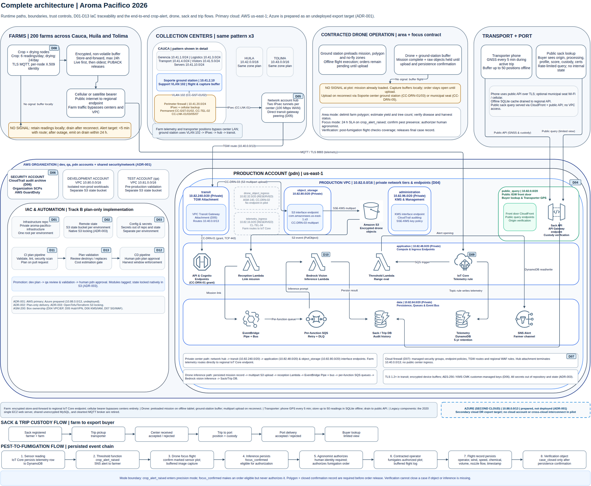

- **Vector SVG:** [`complete/architecture.svg`](complete/architecture.svg)
- **Draw.io Source:** [`complete/architecture.drawio`](complete/architecture.drawio) (Page 1)
- Shows the end-to-end runtime architecture across cloud and edge tiers, multi-account isolation, network routing, and D01–D13 IaC component badges, derived from `docs/architecture.md` §4, §7, §11, and §14.

### Complete Architecture (IaC Traceability)

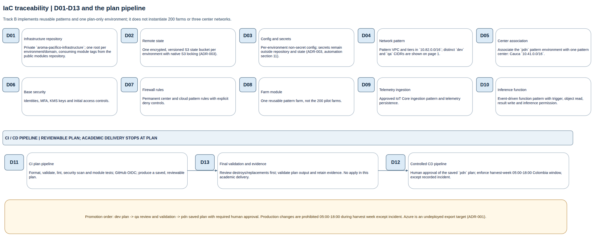

- **Vector SVG:** [`complete/architecture-iac.svg`](complete/architecture-iac.svg)
- **Draw.io Source:** [`complete/architecture.drawio`](complete/architecture.drawio) (Page 2)
- Maps Track B implementation boxes D01 through D13 and details the multi-stage reviewable plan and promotion pipeline across environments, derived from `docs/architecture.md` §14 and `docs/automation-and-pipelines.md` §3-5.

---

## 2. Accounts and Landing Zone (`accounts/`)

The `accounts/` package models the AWS multi-account governance hierarchy, Service Control Policies (SCPs), Tag Policies, IAM Identity Center workforce authentication, and the centralized compliance audit archive. Detailed documentation is available in [`accounts/README.md`](accounts/README.md).

### Landing Zone, Controls, Identity, Budgets and Auditing

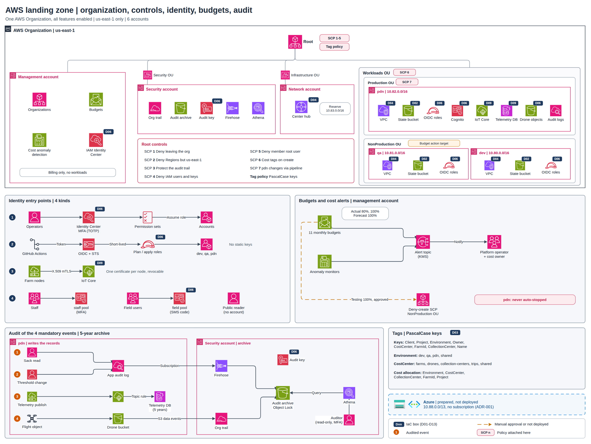

- **Vector SVG:** [`accounts/landing-zone.svg`](accounts/landing-zone.svg)
- **Draw.io Source:** [`accounts/landing-zone.drawio`](accounts/landing-zone.drawio)
- Illustrates the AWS Organization multi-account structure, root-level Service Control Policies and Tag Policies, four identity entry points, budget alerts, and five-year compliance audit trail, derived from `docs/landing-zone.md` §3-7 and `docs/security-and-identity.md` §2-4.

---

## 3. Network Architecture (`network/`)

The `network/` package defines the IPv4 addressing strategy, regional collection center infrastructure, edge-to-cloud connectivity paths, and offline no-signal tolerance. Detailed documentation is available in [`network/README.md`](network/README.md).

### Cloud and Site Addressing Plan

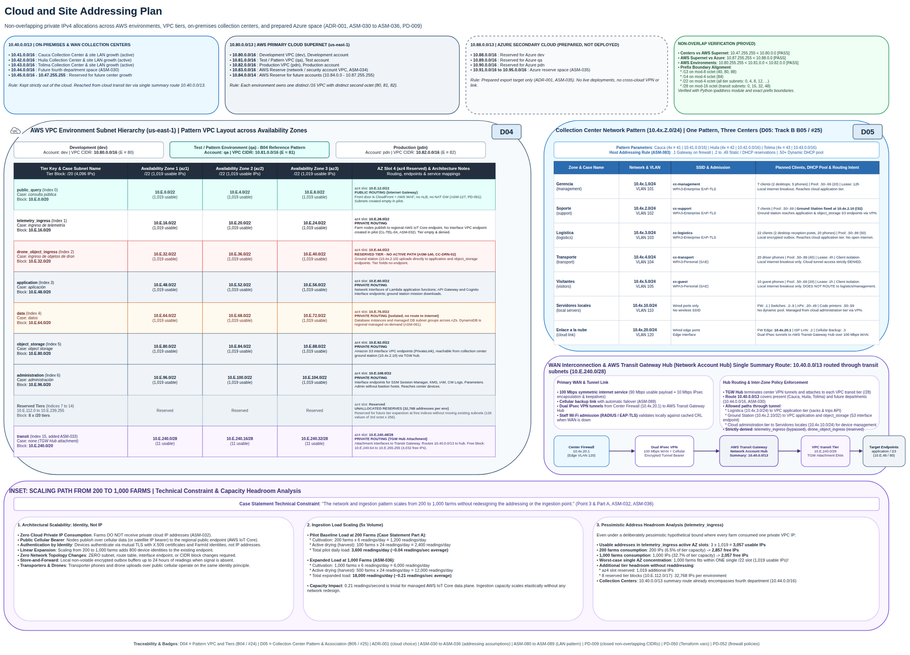

- **Vector SVG:** [`network/addressing-plan.svg`](network/addressing-plan.svg)
- **Draw.io Source:** [`network/addressing-plan.drawio`](network/addressing-plan.drawio)
- Details the top-level RFC 1918 partition across on-premises, AWS primary cloud, and undeployed Azure space, including VPC subnet tiering and scaling from 200 to 1,000 farms without address redesign, derived from `docs/addressing-plan.md` §2-5.

### Collection Center Network Pattern

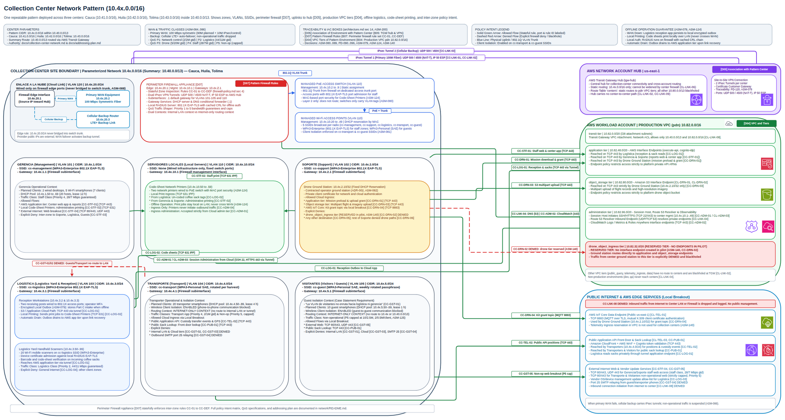

- **Vector SVG:** [`network/collection-center.svg`](network/collection-center.svg)
- **Draw.io Source:** [`network/collection-center.drawio`](network/collection-center.drawio)
- Models the standardized regional collection center LAN architecture across seven segmented network zones, perimeter firewall enforcement, dual WAN IPsec links to Transit Gateway, and local logistics workflows, derived from `docs/collection-center-network.md` §2-6 and `docs/firewall-policy.md` §4.

### End-to-End Connectivity Architecture

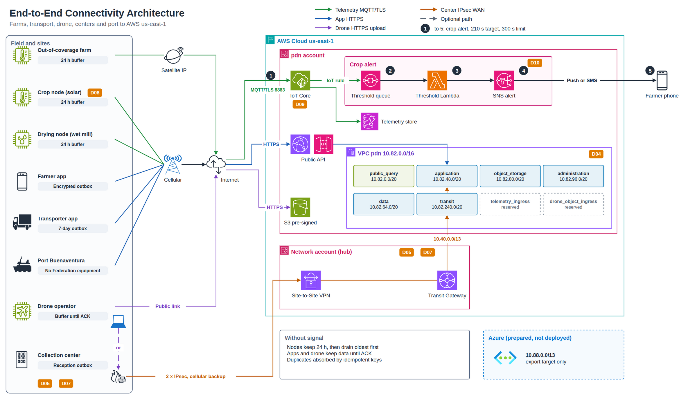

- **Vector SVG:** [`network/connectivity.svg`](network/connectivity.svg)
- **Draw.io Source:** [`network/connectivity.drawio`](network/connectivity.drawio)
- Diagrams all seven end-to-end connectivity flows connecting farm sensor nodes, wet mills, drone ground stations, transporters, collection centers, and the Port of Buenaventura into cloud endpoints, derived from `docs/connectivity.md` §2-11.

### No-Signal Handling and Crop Alert Sequence

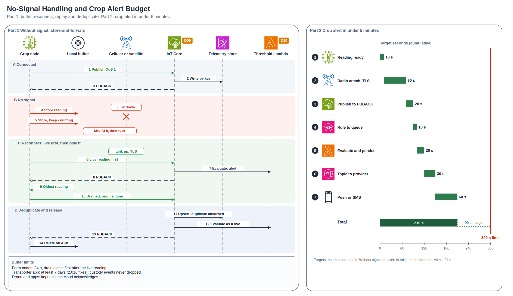

- **Vector SVG:** [`network/no-signal-sequence.svg`](network/no-signal-sequence.svg)
- **Draw.io Source:** [`network/no-signal-sequence.drawio`](network/no-signal-sequence.drawio)
- Documents offline store-and-forward buffering, live-first reconnection drainage, idempotent deduplication, and the seven-hop crop alert latency budget under 300 seconds, derived from `docs/connectivity.md` §4.3, §6, §7, and §8.

---

## 4. Security, Identity and Firewall Policies (`security/`)

The `security/` package illustrates network perimeter boundaries, security group prefix lists, customer-managed KMS encryption keys, and identity revocation procedures. Detailed documentation is available in [`security/README.md`](security/README.md).

### Perimeter and Cloud Firewall Policy

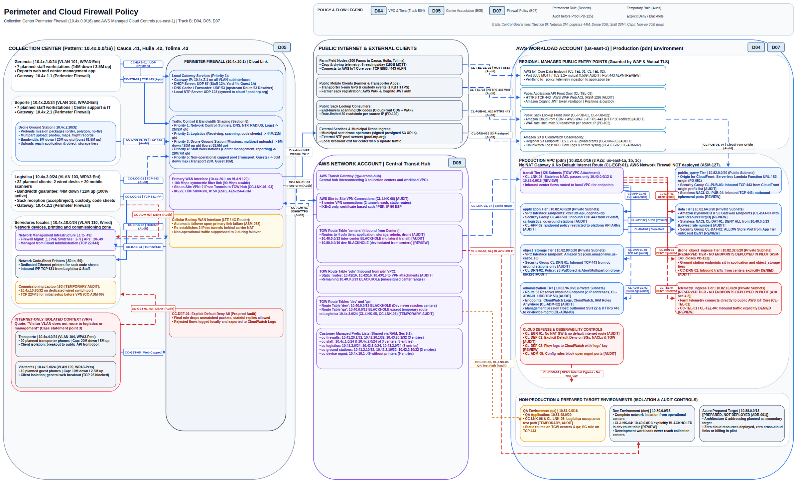

- **Vector SVG:** [`security/firewall-policy.svg`](security/firewall-policy.svg)
- **Draw.io Source:** [`security/firewall-policy.drawio`](security/firewall-policy.drawio)
- Depicts the multi-tier defense-in-depth security perimeter, including on-premises collection center firewall rules, cloud security groups, interface endpoint policies, and AWS WAF rate limiting, derived from `docs/firewall-policy.md` §3-6.

### Identity and Access Architecture

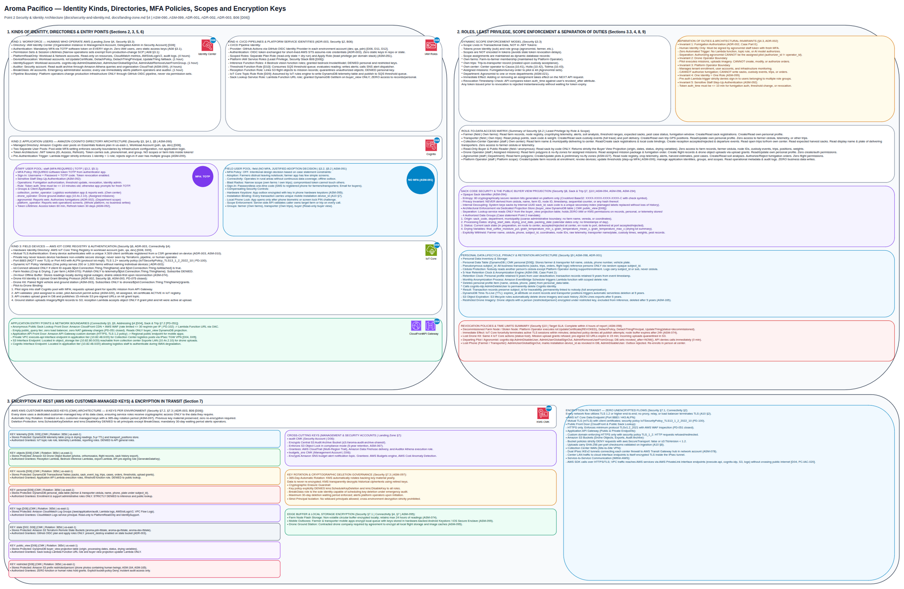

- **Vector SVG:** [`security/identity-and-access.svg`](security/identity-and-access.svg)
- **Draw.io Source:** [`security/identity-and-access.drawio`](security/identity-and-access.drawio)
- Defines the five functional security tiers encompassing human operators, edge IoT certificates, Cognito user pools, least-privilege IAM roles, and the eight customer-managed KMS encryption keys, derived from `docs/security-and-identity.md` §2-7 and §10.

### Credential and Identity Revocation Sequence

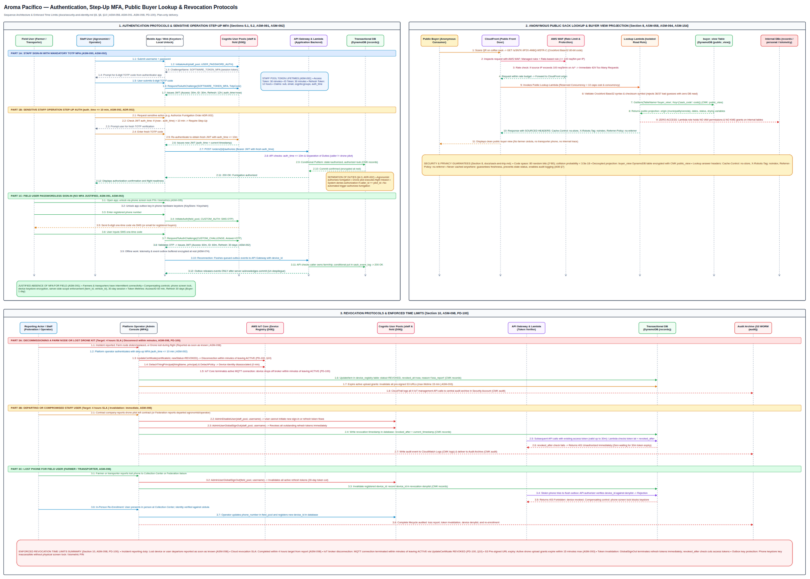

- **Vector SVG:** [`security/revocation-sequence.svg`](security/revocation-sequence.svg)
- **Draw.io Source:** [`security/revocation-sequence.drawio`](security/revocation-sequence.drawio)
- Specifies the sequence for instant credential revocation, certificate retirement in AWS IoT Core, Cognito token invalidation, and session termination across all actor types, derived from `docs/security-and-identity.md` §10.

---

## 5. Workflows, Sequences and State Machines (`flows/`)

The `flows/` package contains lifecycle state machines and detailed message sequence diagrams governing farm alerts, drone missions, ML inference, and sack custody. Detailed documentation is available in [`flows/README.md`](flows/README.md).

### Drone Fumigation Sequence

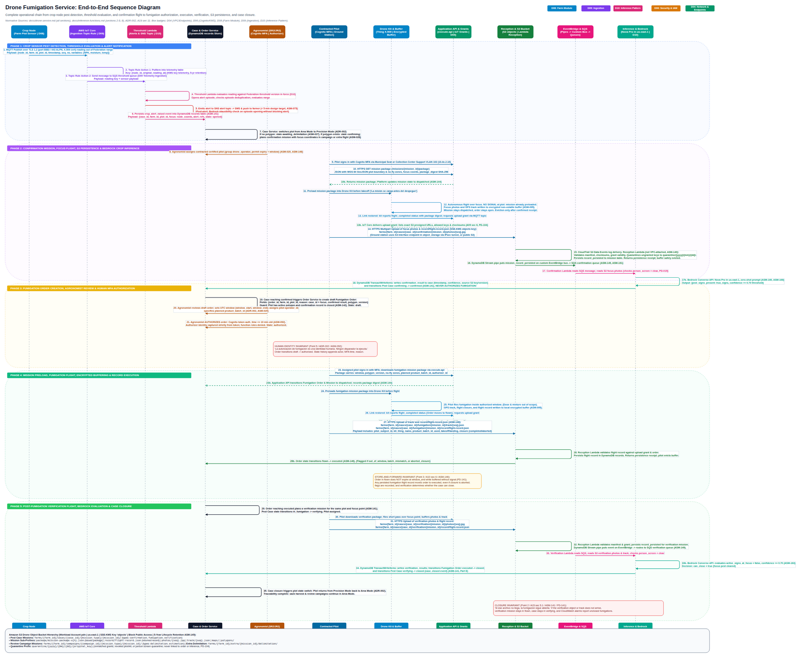

- **Vector SVG:** [`flows/drone-fumigation-sequence.svg`](flows/drone-fumigation-sequence.svg)
- **Draw.io Source:** [`flows/drone-fumigation-sequence.drawio`](flows/drone-fumigation-sequence.drawio)
- Traces the end-to-end pest-to-fumigation event sequence across its eight ordered gates from alert triggering through agronomist MFA authorization to flight record persistence and case closure, derived from `docs/drone-service.md` §3-6 and §10.

### Drone State Machines

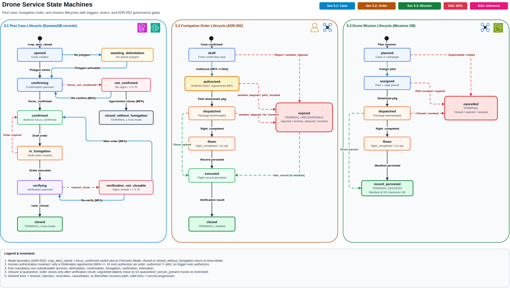

- **Vector SVG:** [`flows/drone-state-machines.svg`](flows/drone-state-machines.svg)
- **Draw.io Source:** [`flows/drone-state-machines.drawio`](flows/drone-state-machines.drawio)
- Defines the dual state machine models governing drone mission execution and prescription lifecycle transitions, derived from `docs/drone-service.md` §5.

### Farm Monitoring and Pilot Alerts Sequence

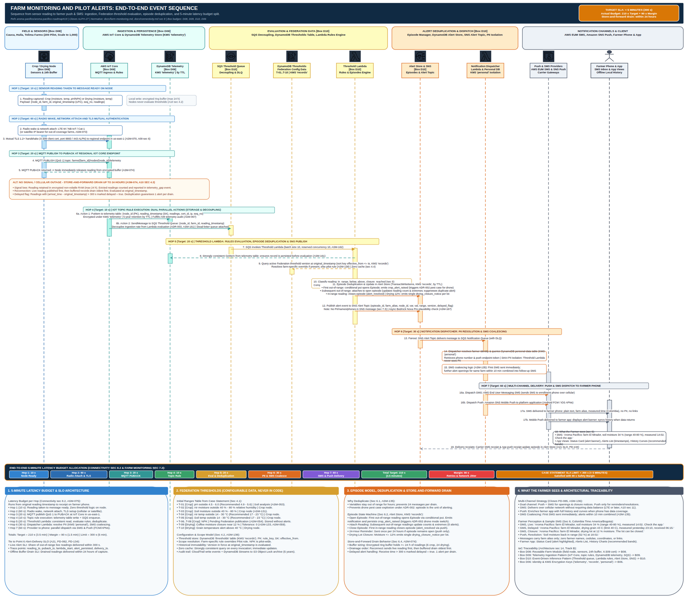

- **Vector SVG:** [`flows/farm-monitoring-sequence.svg`](flows/farm-monitoring-sequence.svg)
- **Draw.io Source:** [`flows/farm-monitoring-sequence.drawio`](flows/farm-monitoring-sequence.drawio)
- Details the telemetry event sequence from sensor measurement to dual IoT topic ingestion, threshold evaluation, episode deduplication, and farmer notification delivery, derived from `docs/farm-monitoring.md` §3-7 and `docs/connectivity.md` §8.

### Event-Driven Inference Functions Architecture

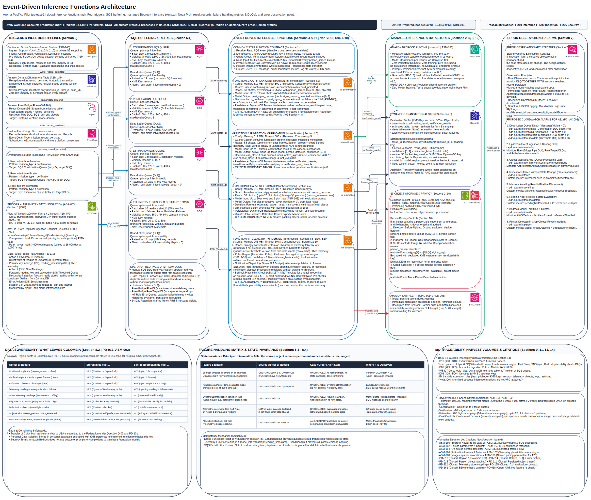

- **Vector SVG:** [`flows/inference-functions.svg`](flows/inference-functions.svg)
- **Draw.io Source:** [`flows/inference-functions.drawio`](flows/inference-functions.drawio)
- Architecturally diagrams the four event-driven inference triggers, Amazon Bedrock foundation model invocation, SQS dead-letter queues, and on-device person screening, derived from `docs/inference-functions.md` §2-6 and §10.

### Sack and Trip Custody Sequence

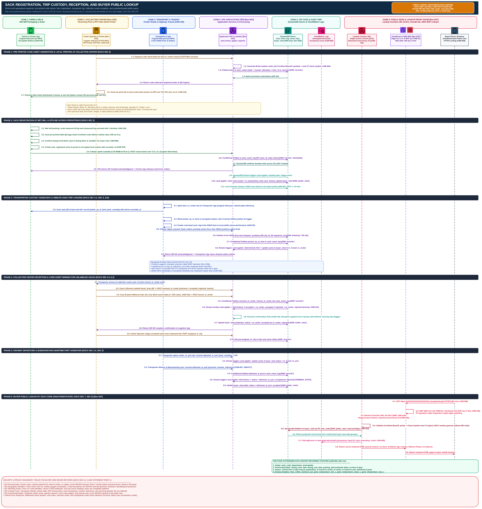

- **Vector SVG:** [`flows/sack-and-trip-sequence.svg`](flows/sack-and-trip-sequence.svg)
- **Draw.io Source:** [`flows/sack-and-trip-sequence.drawio`](flows/sack-and-trip-sequence.drawio)
- Models the interaction lifecycle for sack registration, transporter custody transfers across transit legs, and unauthenticated buyer QR code verification, derived from `docs/sack-and-trip.md` §2, §4, §5, and §7.

### Sack Lifecycle State Machine

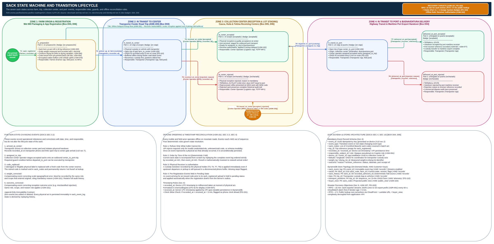

- **Vector SVG:** [`flows/sack-states.svg`](flows/sack-states.svg)
- **Draw.io Source:** [`flows/sack-states.drawio`](flows/sack-states.drawio)
- Specifies the finite state transitions for 60 kg coffee sacks from wet mill creation to port delivery and commercial sale, derived from `docs/sack-and-trip.md` §3.

---

## 6. Automation and Pipelines (`pipelines/`)

The `pipelines/` package details ingestion pipelines and the multi-environment Terraform delivery automation. Detailed documentation is available in [`pipelines/README.md`](pipelines/README.md).

### Telemetry Ingestion and Flight-Object Reception Pipelines

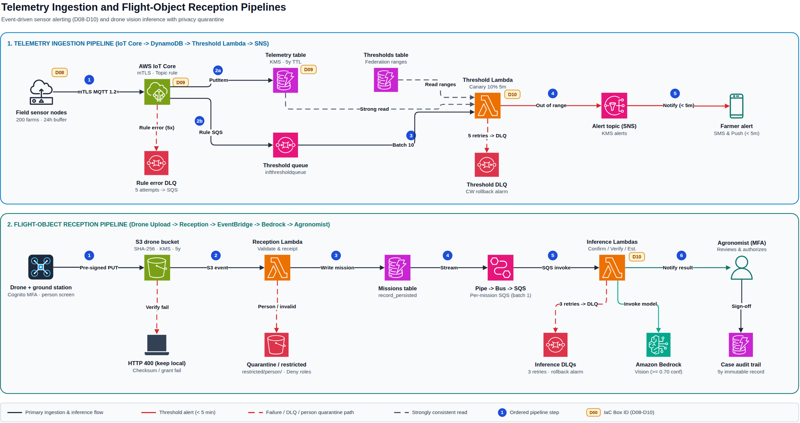

- **Vector SVG:** [`pipelines/ingestion-and-flight-objects.svg`](pipelines/ingestion-and-flight-objects.svg)
- **Draw.io Source:** [`pipelines/ingestion-and-flight-objects.drawio`](pipelines/ingestion-and-flight-objects.drawio)
- Depicts the parallel telemetry ingestion engine and the pre-signed S3 flight object reception pipeline with SHA-256 validation and quarantine routing, derived from `docs/automation-and-pipelines.md` §6-7 and `docs/farm-monitoring.md` §3-5.

### Platform CI/CD Deployment Pipeline

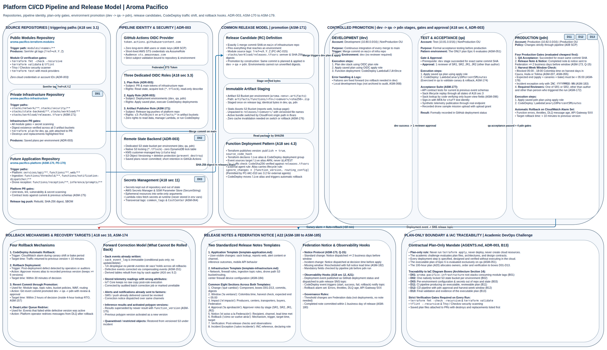

- **Vector SVG:** [`pipelines/platform-pipeline.svg`](pipelines/platform-pipeline.svg)
- **Draw.io Source:** [`pipelines/platform-pipeline.drawio`](pipelines/platform-pipeline.drawio)
- Illustrates the GitHub Actions CI/CD deployment pipeline, branch promotion gates across environments, reviewable plan generation, and harvest-week freeze windows, derived from `docs/automation-and-pipelines.md` §3-5, §8, and §10.

### IaC CI & Reusable Module Release Sequence

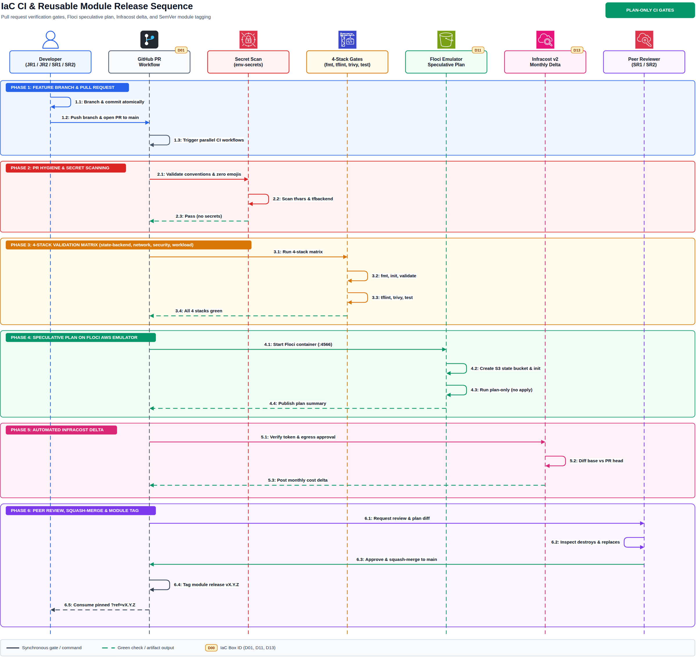

- **Vector SVG:** [`pipelines/iac-ci-sequence.svg`](pipelines/iac-ci-sequence.svg)
- **Draw.io Source:** [`pipelines/iac-ci-sequence.drawio`](pipelines/iac-ci-sequence.drawio)
- Sequence diagram detailing pull request hygiene, secret scanning, parallel 4-stack matrix gates (fmt, validate, tflint, trivy, terraform test), speculative plan against the Floci AWS emulator (pc-iac-028), Infracost monthly cost delta (pc-iac-027), cross-provider review, and immutable SemVer module release tagging (pc-iac-015), derived from `standards/iac-rules/` and ADR-003.

### IaC CD Provisioning Sequence

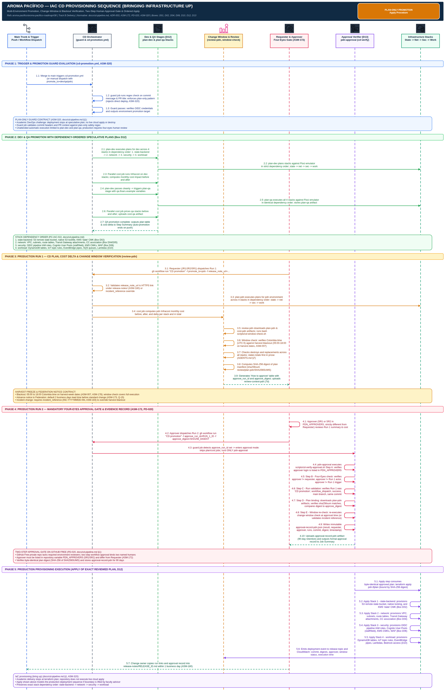

- **Vector SVG:** [`pipelines/iac-provisioning-sequence.svg`](pipelines/iac-provisioning-sequence.svg)
- **Draw.io Source:** [`pipelines/iac-provisioning-sequence.drawio`](pipelines/iac-provisioning-sequence.drawio)
- Sequence diagram detailing controlled multi-environment promotion (dev -> qa -> pdn), plan-only guard enforcement (ASM-320), harvest blackout verification (05:00–18:00 Colombia time, ASM-007, ASM-178), two-step production workflow approval binding two named humans to the SHA-256 plan digest (PD-020, ASM-172), and provisioning in strict dependency order (state-backend -> network -> security -> workload), derived from `docs/cd-pipeline.md` §1-5.

### IaC Teardown & Rollback Sequence

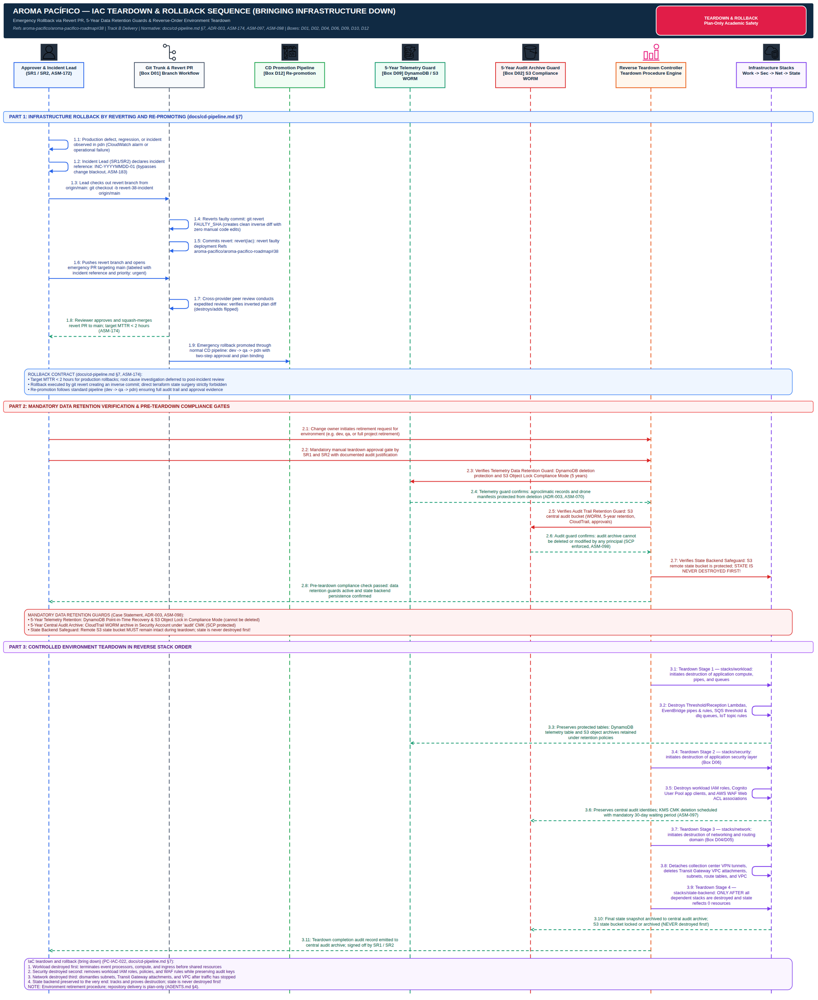

- **Vector SVG:** [`pipelines/iac-teardown-and-rollback-sequence.svg`](pipelines/iac-teardown-and-rollback-sequence.svg)
- **Draw.io Source:** [`pipelines/iac-teardown-and-rollback-sequence.drawio`](pipelines/iac-teardown-and-rollback-sequence.drawio)
- Sequence diagram detailing emergency rollback by reverting and re-promoting with inverted speculative plan review (ASM-174, ASM-184), pre-teardown verification of 5-year data retention compliance guards (DynamoDB deletion protection, S3 Object Lock Compliance Mode, central audit archive, and remote state persistence safeguard), and environment teardown in reverse stack dependency order (workload -> security -> network -> state-backend), derived from `docs/cd-pipeline.md` §7.

---

## 7. Legacy 2020 Traceability (`legacy/`)

The `legacy/` package documents the evolution of the 2020 pilot requirements into the modern 2026 architecture. Detailed documentation is available in [`legacy/README.md`](legacy/README.md).

### 2020 Legacy Mapping (Keep, Retire, and Replace)

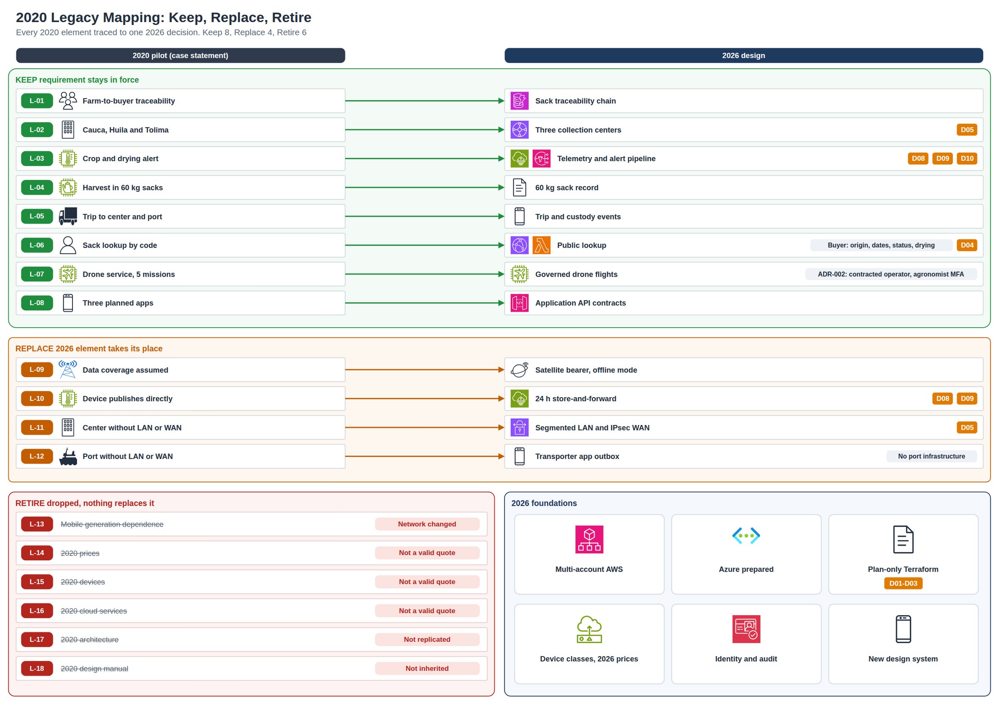

- **Vector SVG:** [`legacy/legacy-2020.svg`](legacy/legacy-2020.svg)
- **Draw.io Source:** [`legacy/legacy-2020.drawio`](legacy/legacy-2020.drawio)
- Maps the seventeen 2020 pilot elements to their definitive 2026 architectural decisions (Keep, Retire, or Replace) and corresponding IaC implementation boxes, derived from `docs/legacy-2020.md` §2-4.

---

## 8. Data Paths (`data-paths/`)

The `data-paths/` package documents edge telemetry ingestion, transporter GNSS breadcrumbs, and drone mission package reception. Detailed documentation is available in [`data-paths/data-paths.md`](data-paths/data-paths.md).

### Crop and Drying Telemetry Data Path

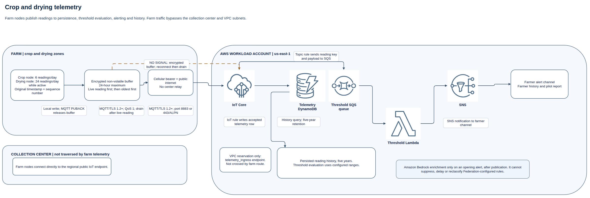

- **Vector SVG:** [`data-paths/telemetry.svg`](data-paths/telemetry.svg)
- **Draw.io Source:** [`data-paths/telemetry.drawio`](data-paths/telemetry.drawio)
- Outlines crop and drying sensor telemetry ingestion via MQTT over TLS to AWS IoT Core, DynamoDB storage, and alert evaluation, derived from `docs/connectivity.md` §4 and `data-paths/data-paths.md`.

### Transporter Position Data Path

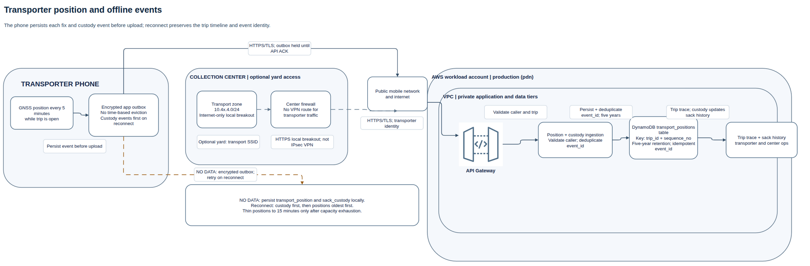

- **Vector SVG:** [`data-paths/transporter-position.svg`](data-paths/transporter-position.svg)
- **Draw.io Source:** [`data-paths/transporter-position.drawio`](data-paths/transporter-position.drawio)
- Traces transporter GNSS position logging, encrypted mobile outbox buffering, cellular upload, and overland journey tracking between farms, collection centers, and the Port of Buenaventura, derived from `docs/connectivity.md` §7 and `data-paths/data-paths.md`.

### Drone Objects Data Path

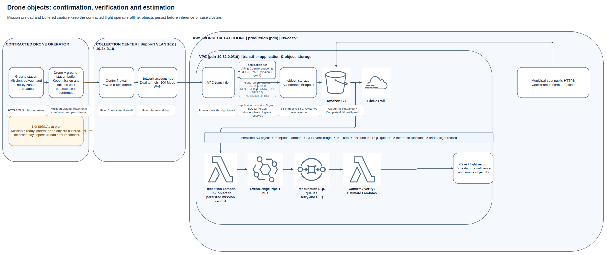

- **Vector SVG:** [`data-paths/drone-objects.svg`](data-paths/drone-objects.svg)
- **Draw.io Source:** [`data-paths/drone-objects.drawio`](data-paths/drone-objects.drawio)
- Illustrates drone mission package uploads, pre-signed S3 URL generation, checksum verification, on-device person screening, and quarantine isolation, derived from `docs/connectivity.md` §6 and `data-paths/data-paths.md`.

---

## Complete Repository File Inventory

In accordance with documentation standards, the directory tree below inventories every tracked file on `main` across the repository.

```text
aroma-pacifico-diagrams/
|-- .agents/
|   `-- skills/
|       |-- diagram-agent/
|       |   `-- SKILL.md
|       |-- doc-agent/
|       |   `-- SKILL.md
|       `-- git-agent/
|           `-- SKILL.md
|-- .claude/
|   `-- settings.json
|-- .github/
|   |-- pull_request_template.md
|   `-- workflows/
|       `-- pr-conventions.yml
|-- .gitignore
|-- .gitmessage
|-- AGENTS.md
|-- CLAUDE.md
|-- CONTRIBUTING.md
|-- GEMINI.md
|-- README.md
|-- accounts/
|   |-- README.md
|   |-- landing-zone.drawio
|   |-- landing-zone.png
|   `-- landing-zone.svg
|-- complete/
|   |-- README.md
|   |-- architecture-iac.png
|   |-- architecture-iac.svg
|   |-- architecture.drawio
|   |-- architecture.png
|   `-- architecture.svg
|-- data-paths/
|   |-- data-paths.md
|   |-- drone-objects.drawio
|   |-- drone-objects.png
|   |-- drone-objects.svg
|   |-- telemetry.drawio
|   |-- telemetry.png
|   |-- telemetry.svg
|   |-- transporter-position.drawio
|   |-- transporter-position.png
|   `-- transporter-position.svg
|-- docs/
|   `-- case/
|       `-- case-statement.pdf
|-- flows/
|   |-- README.md
|   |-- drone-fumigation-sequence.drawio
|   |-- drone-fumigation-sequence.png
|   |-- drone-fumigation-sequence.svg
|   |-- drone-state-machines.drawio
|   |-- drone-state-machines.png
|   |-- drone-state-machines.svg
|   |-- farm-monitoring-sequence.drawio
|   |-- farm-monitoring-sequence.png
|   |-- farm-monitoring-sequence.svg
|   |-- inference-functions.drawio
|   |-- inference-functions.png
|   |-- inference-functions.svg
|   |-- sack-and-trip-sequence.drawio
|   |-- sack-and-trip-sequence.png
|   |-- sack-and-trip-sequence.svg
|   |-- sack-states.drawio
|   |-- sack-states.png
|   `-- sack-states.svg
|-- legacy/
|   |-- README.md
|   |-- legacy-2020.drawio
|   |-- legacy-2020.png
|   `-- legacy-2020.svg
|-- network/
|   |-- README.md
|   |-- addressing-plan.drawio
|   |-- addressing-plan.png
|   |-- addressing-plan.svg
|   |-- collection-center.drawio
|   |-- collection-center.png
|   |-- collection-center.svg
|   |-- connectivity.drawio
|   |-- connectivity.png
|   |-- connectivity.svg
|   |-- no-signal-sequence.drawio
|   |-- no-signal-sequence.png
|   `-- no-signal-sequence.svg
|-- pipelines/
|   |-- README.md
|   |-- ingestion-and-flight-objects.drawio
|   |-- ingestion-and-flight-objects.png
|   |-- ingestion-and-flight-objects.svg
|   |-- platform-pipeline.drawio
|   |-- platform-pipeline.png
|   `-- platform-pipeline.svg
|-- security/
|   |-- README.md
|   |-- firewall-policy.drawio
|   |-- firewall-policy.png
|   |-- firewall-policy.svg
|   |-- identity-and-access.drawio
|   |-- identity-and-access.png
|   |-- identity-and-access.svg
|   |-- revocation-sequence.drawio
|   |-- revocation-sequence.png
|   `-- revocation-sequence.svg
`-- standards/
    |-- diagrams.md
    |-- documentation.md
    |-- git-workflow.md
    |-- iac-rules/
    |   |-- README.md
    |   |-- pc-iac-001.md
    |   |-- pc-iac-002.md
    |   |-- pc-iac-003.md
    |   |-- pc-iac-004.md
    |   |-- pc-iac-005.md
    |   |-- pc-iac-006.md
    |   |-- pc-iac-007.md
    |   |-- pc-iac-008.md
    |   |-- pc-iac-009.md
    |   |-- pc-iac-010.md
    |   |-- pc-iac-011.md
    |   |-- pc-iac-012.md
    |   |-- pc-iac-013.md
    |   |-- pc-iac-014.md
    |   |-- pc-iac-015.md
    |   |-- pc-iac-016.md
    |   |-- pc-iac-017.md
    |   |-- pc-iac-018.md
    |   |-- pc-iac-019.md
    |   |-- pc-iac-020.md
    |   |-- pc-iac-021.md
    |   |-- pc-iac-022.md
    |   |-- pc-iac-023.md
    |   |-- pc-iac-024.md
    |   |-- pc-iac-025.md
    |   `-- pc-iac-026.md
    `-- terraform-iac-best-practices.md
```

---

## IaC Component Traceability (Boxes D01 through D13)

The numbered badges D01 through D13 establish bidirectional traceability between architectural diagrams and Track B Terraform implementation modules, aligned with `docs/architecture.md` Section 14.

Traceability Rule: The table below is the exact inverse of the Master Diagram Catalog, listing every diagram that badges or names each respective D-box.

| Badge | Track B Issue | Component Description | Primary Diagrams Showing Box |
|---|---|---|---|
| **D01** | B01 (`#21`) | Root stacks per environment and module structure | `complete/architecture.drawio` (Pages 1 & 2), `pipelines/platform-pipeline.drawio`, `legacy/legacy-2020.drawio` |
| **D02** | B02 (`#22`) | S3 Terraform state bucket with native locking | `complete/architecture.drawio` (Pages 1 & 2), `accounts/landing-zone.drawio`, `security/identity-and-access.drawio`, `pipelines/platform-pipeline.drawio` |
| **D03** | B03 (`#23`) | Environment configuration and variable management | `complete/architecture.drawio` (Pages 1 & 2), `accounts/landing-zone.drawio`, `pipelines/platform-pipeline.drawio`, `legacy/legacy-2020.drawio` |
| **D04** | B04 (`#24`) | VPC and subnet tiers of the pattern environment | `complete/architecture.drawio` (Pages 1 & 2), `accounts/landing-zone.drawio`, `network/addressing-plan.drawio`, `network/collection-center.drawio`, `network/connectivity.drawio`, `security/firewall-policy.drawio`, `flows/drone-fumigation-sequence.drawio`, `flows/sack-and-trip-sequence.drawio`, `flows/sack-states.drawio`, `pipelines/platform-pipeline.drawio`, `legacy/legacy-2020.drawio` |
| **D05** | B05 (`#25`) | Collection center association, WAN links and TGW | `complete/architecture.drawio` (Pages 1 & 2), `network/addressing-plan.drawio`, `network/collection-center.drawio`, `network/connectivity.drawio`, `security/firewall-policy.drawio`, `flows/sack-and-trip-sequence.drawio`, `flows/sack-states.drawio`, `pipelines/platform-pipeline.drawio`, `legacy/legacy-2020.drawio` |
| **D06** | B06 (`#26`) | Identities, KMS keys and initial access controls | `complete/architecture.drawio` (Pages 1 & 2), `accounts/landing-zone.drawio`, `network/connectivity.drawio`, `security/identity-and-access.drawio`, `security/revocation-sequence.drawio`, `flows/drone-fumigation-sequence.drawio`, `flows/drone-state-machines.drawio`, `flows/farm-monitoring-sequence.drawio`, `flows/inference-functions.drawio`, `flows/sack-and-trip-sequence.drawio`, `flows/sack-states.drawio`, `pipelines/platform-pipeline.drawio`, `legacy/legacy-2020.drawio` |
| **D07** | B07 (`#27`) | Pattern firewall rules, security groups and WAF | `complete/architecture.drawio` (Pages 1 & 2), `network/collection-center.drawio`, `network/connectivity.drawio`, `security/firewall-policy.drawio`, `flows/sack-and-trip-sequence.drawio` |
| **D08** | B08 (`#28`) | Reusable farm module for pattern farm telemetry | `complete/architecture.drawio` (Pages 1 & 2), `network/connectivity.drawio`, `security/identity-and-access.drawio`, `security/revocation-sequence.drawio`, `flows/drone-fumigation-sequence.drawio`, `flows/farm-monitoring-sequence.drawio`, `pipelines/ingestion-and-flight-objects.drawio`, `pipelines/platform-pipeline.drawio`, `legacy/legacy-2020.drawio` |
| **D09** | B09 (`#29`) | Telemetry ingestion pattern module (IoT Core) | `complete/architecture.drawio` (Pages 1 & 2), `accounts/landing-zone.drawio`, `network/connectivity.drawio`, `network/no-signal-sequence.drawio`, `security/identity-and-access.drawio`, `flows/drone-fumigation-sequence.drawio`, `flows/drone-state-machines.drawio`, `flows/farm-monitoring-sequence.drawio`, `flows/inference-functions.drawio`, `pipelines/ingestion-and-flight-objects.drawio`, `legacy/legacy-2020.drawio` |
| **D10** | B10 (`#30`) | Event-driven inference functions pattern | `complete/architecture.drawio` (Pages 1 & 2), `network/connectivity.drawio`, `network/no-signal-sequence.drawio`, `flows/drone-fumigation-sequence.drawio`, `flows/drone-state-machines.drawio`, `flows/farm-monitoring-sequence.drawio`, `flows/inference-functions.drawio`, `pipelines/ingestion-and-flight-objects.drawio`, `pipelines/platform-pipeline.drawio`, `legacy/legacy-2020.drawio` |
| **D11** | B11 (`#31`) | CI pipeline generating executable reviewable plans | `complete/architecture.drawio` (Pages 1 & 2), `pipelines/platform-pipeline.drawio` |
| **D12** | B12 (`#32`) | CD pipeline with approval gates and freeze windows | `complete/architecture.drawio` (Pages 1 & 2), `pipelines/platform-pipeline.drawio` |
| **D13** | B13 (`#33`) | Plan validation and evidence verification | `complete/architecture.drawio` (Pages 1 & 2), `pipelines/platform-pipeline.drawio` |\n