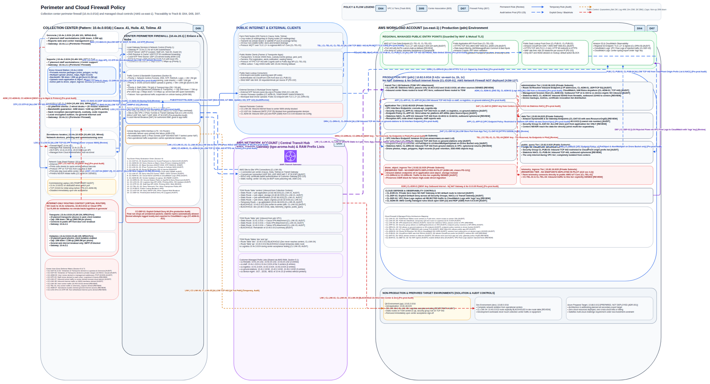

# Perimeter and Cloud Firewall Policy

Documentation for the perimeter and cloud firewall policy diagram of the Aroma Pacífico coffee traceability pilot (2026 update).

## Files in this Directory

- [firewall-policy.drawio](firewall-policy.drawio): Primary uncompressed Draw.io XML diagram source with full geometry, connectors, zones, and metadata.
- [firewall-policy.svg](firewall-policy.svg): Headless vector publication export with embedded diagram data.
- [firewall-policy.png](firewall-policy.png): High-resolution raster preview export (2400 pixels width).

## Preview

## What the Diagram Shows

This diagram illustrates the comprehensive perimeter firewall and cloud firewall policy for the Aroma Pacífico pilot, linking edge collection centers with AWS managed cloud environments:

1. **Collection Center Perimeter Firewall (Pattern `10.4x.0.0/16` | Cauca `.41`, Huila `.42`, Tolima `.43`)**:
   - Six structured LAN zones: Gerencia (`10.4x.1.0/24`), Soporte (`10.4x.2.0/24`), Drone Ground Station (`10.4x.2.10/32`), Servicios Locales (`10.4x.10.0/24`), Transporte (`10.4x.4.0/24`), and Visitantes (`10.4x.5.0/24`).
   - Center Perimeter Firewall subinterfaces (`10.4x.20.1` gateway) with top-down policy evaluation, local gateway services (DNS forwarder, DHCP relay, local NTP server).
   - Traffic control and bandwidth shaping enforcement under Section 8: Network Control (2M/2M), Logistics (44M/11M up/down, 100% active, 45% during satellite failover), Drone Ground Station (20M/5M burst), Staff (28M/7M), and Non-operational capped pool (30M down / 7.5M up total; 2M down / 0.5M up per client).
   - Cellular backup WAN interface (LTE/4G) with automatic failover upon primary link failure (ASM-078) and automatic re-establishment of IPsec tunnels.
   - Strict inter-zone isolation: guest/transporter devices denied access to private ranges; printers isolated from internet; administrative and commissioning ports tightly bounded.

2. **Public Internet & Central Transit Hub**:
   - Public clients: Farm field nodes (crop and drying telemetry via MQTT/TLS), transporter/farmer mobile applications (Cognito-authenticated REST API), public sack lookup consumers (CloudFront/WAF rate-limited 30/min), and municipal seat drone operators.
   - AWS Network Account / Central Transit Hub (`tgw-aroma-hub`): Route tables for `centers`, `pdn`, `dev`, and `qa`; AWS Site-to-Site VPN attachments (IKEv2, UDP 500/4500, IP 50 ESP); customer-managed prefix lists shared via AWS RAM (`cc-firewalls`, `cc-staff`, `cc-logistics`, `cc-ground-stations`, `cc-device-mgmt`).
   - Isolation guarantees: Blackhole routes preventing center-to-center lateral traversal (`10.40.0.0/13`) and isolating development environments (`10.80.0.0/16`). Temporary scoped route for QA logistics acceptance testing (CL-LNK-05).

3. **AWS Workload Account (`us-east-1`) Production (`pdn` `10.82.0.0/16`) Environment**:
   - Regional Managed Public Entry Points: AWS IoT Core (`CL-TEL-01`, `CL-TEL-02`), Public Application API (`CL-TEL-03`), Public Sack Lookup (`CL-PUB-01`, `CL-PUB-02`), and Amazon S3 Regional Endpoint (`CL-DRN-03`).
   - Production VPC Tiers across 3 AZs (`us-east-1a`, `1b`, `1c`): `transit` (/28 subnets), `application` (`10.82.48.0/20`), `object_storage` (`10.82.80.0/20`), `administration` (`10.82.96.0/20`), `data` (`10.82.64.0/20`), and `public_query` (`10.82.0.0/20`).
   - Explicit Reserved Tiers: `drone_object_ingress` (`10.82.32.0/20`, ASM-140 closing PD-121) and `telemetry_ingress` (`10.82.16.0/20`, A10 section 4.2), showing zero active endpoints in the pilot and explicit denies from on-premise networks.
   - Cloud defense controls: Strict egress isolation (no NAT Gateway, no `0.0.0.0/0` route, `CL-EGR-01`), explicit default deny (`CL-DEF-01`), VPC Flow Logs capture to CloudWatch Logs with `logs` KMS key (`CL-DEF-02`), and AWS Config rules blocking open management ports (`CL-ADM-05`).
   - Non-production & prepared targets: QA environment (`10.81.0.0/16`), Dev environment (`10.80.0.0/16`), and Azure prepared target (`10.88.0.0/13`, ADR-001).

4. **Rule Group Coverage & Visual Encoding**:
   - Covers all 13 rule groups: `GST`, `BAS`, `LNK`, `ADM`, `DRN`, `LOG`, `STF`, `TEL`, `PUB`, `APP`, `DAT`, `EGR`, and `DEF`.
   - Distinct visual dash styles for rule lifecycle classification:
     - Solid Blue (`#2563eb`): Permanent Rule (Subject to scheduled review).
     - Dashed Blue (`#2563eb`): Audit before Production (`PD-125`).
     - Dotted Amber (`#d97706`): Temporary Rule (Active during acceptance/maintenance window; flagged for audit).
     - Dashed Red (`#dc2626`): Explicit Deny / Blackhole Route.

## Traceability to Architecture Boxes (Track B)

This diagram directly satisfies the architectural traceability requirements for the following catalog boxes (defined in `aroma-pacifico-architecture/docs/architecture.md` Section 14):

- **D04**: VPC and tiers of pattern environment (`10.82.0.0/16`). Covers transit, application, object storage, administration, data, and public query tiers, along with reserved tier boundaries.
- **D05**: Association of environment with one pattern collection center (`10.4x.0.0/16`). Shows Site-to-Site VPN connections from Cauca (`.41`), Huila (`.42`), and Tolima (`.43`) to `tgw-aroma-hub` and TGW route table associations.
- **D07**: Pattern firewall rules (security module, Epic 6). Documents the comprehensive 13-rule-group matrix across LAN perimeter interfaces, Transit Gateway, Security Groups, Stateless NACLs, and AWS WAF Web ACLs.

## Source Documents and References

The diagram and rule mappings are grounded strictly in the normative project documentation:

- `aroma-pacifico-architecture/docs/firewall-policy.md`:
  - Section 2: Rule identifier format (`CC-*` and `CL-*`).
  - Section 3: Collection center perimeter policy (10-rule group top-down matrix).
  - Section 4: Cloud policy in AWS (rule groups `CL-TEL`, `CL-PUB`, `CL-DRN`, `CL-APP`, `CL-DAT`, `CL-ADM`, `CL-LNK`, `CL-EGR`, `CL-DEF`).
  - Section 5: Managed rule groups, prefix lists, and AWS RAM sharing.
  - Section 6: Non-production environments, temporary rules, and audit schedules.
  - Section 7: Audit rules before production (`PD-125`).
  - Section 8: Traffic control, priority classes, and bandwidth guarantees.
- `aroma-pacifico-architecture/docs/collection-center-network.md`:
  - Section 6: Perimeter firewall rules and interface mappings.
  - Section 7: Device management IP allocation (`10.4x.10.0/24`).
  - Section 8: Bandwidth allocation, priority queues, and traffic shaping.
- `aroma-pacifico-architecture/docs/architecture.md`:
  - Section 14: Traceability box catalog (D04, D05, D07).
  - Section 12: Network topology and IP address allocations.
